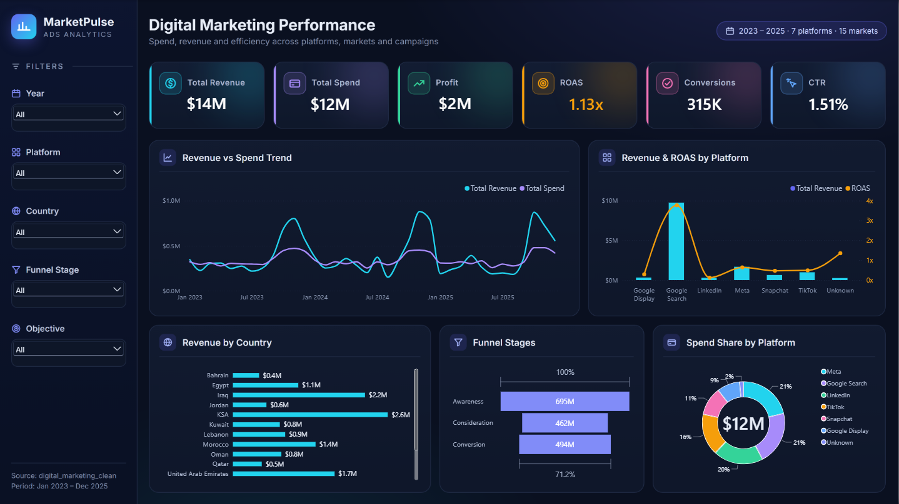

# Digital Marketing Performance Dashboard

A Power BI dashboard (saved as a **Power BI Project, `.pbip`**) that analyzes paid-media performance across 7 ad platforms and 15 markets from January 2023 to December 2025 (29,775 rows).

The report, semantic model and every measure are stored as plain text (PBIR JSON + TMDL), so the whole dashboard can be reviewed and versioned in Git.



## Data preparation (Python)

The raw data (30,300 rows, 35 columns) was cleaned in Python with pandas before loading into Power BI. The notebook [`notebooks/data_cleaning.ipynb`](notebooks/data_cleaning.ipynb) produces `data/digital_marketing_clean.csv` (29,775 rows, 33 columns).

[](https://colab.research.google.com/drive/1szSLIWF-6EAwi2bNGrLC0BkUCF-iO-hZ)

Cleaning steps:

1. **Duplicates and redundant columns:** drop duplicate rows and the text copies of `is_holiday` / `is_weekend`; trim whitespace in all text columns.
2. **Standardize categories:** unify country names (`ksa` → `KSA`, `uae` → `United Arab Emirates`, ...), title-case tier/stage/objective fields, and merge platform variants (`Instagram`/`Facebook` → `Meta`, `Tik Tok` → `TikTok`, ...).
3. **Numeric fields:** strip currency symbols and text from spend, impressions, clicks and revenue; convert EGP amounts to USD (assumed rate 1 USD = 50 EGP).
4. **Dates:** parse mixed formats (`YYYY-MM-DD`, `DD/MM/YYYY`, `MM/DD/YYYY`), drop rows with no valid date, and rebuild year, month, week, weekday and weekend flags from the clean date.
5. **Outliers and invalid values:** set negatives, placeholder values (9,999,999) and impossible values to missing (reach ≥ 100M, conversions ≥ 100K, post hour outside 0–23, frequency outside 0–100, reach > impressions).
6. **Missing labels:** fill missing country, platform, account and campaign name with `Unknown`.
7. **Recalculate** frequency as impressions ÷ reach.

The raw file (`digital_marketing_dataset_dirty.csv`) is not included in this repository.

## What's on the page

| Area | Visual | What it answers |
|---|---|---|
| KPI cards | Total Revenue, Total Spend, Profit, ROAS, Conversions, CTR | Headline performance for the current filter selection |
| Revenue vs Spend Trend | Line chart (monthly) | How revenue and spend move over time |
| Revenue & ROAS by Platform | Column + line combo | Which platforms bring revenue, and how efficiently |
| Revenue by Country | Bar chart | Which markets earn the most |
| Funnel Stages | Funnel (impressions) | Volume through Awareness → Consideration → Conversion |
| Spend Share by Platform | Donut | Where the budget goes |
| Filters | Year, Platform, Country, Funnel Stage, Objective | Slice everything above |

## Key findings (full period)

- **Google Search is the only clearly profitable platform**: ROAS 3.77x on 21% of spend.
- **LinkedIn takes ~20% of the budget at 0.12x ROAS**, the weakest return.
- Overall ROAS is **1.13x**. Revenue grew 4.4% in 2024, then fell 8.3% in 2025 on almost flat spend.

## Data model

- `digital_marketing_clean`: fact table loaded from `data/digital_marketing_clean.csv`.
- `Calendar`: date table (marked as date table), related to the fact table on `date`.
- `_Measures`: report measures in display folders:
  - **01 Financial**: Profit, ROI %, Profit Margin %, Revenue per Conversion
  - **02 Efficiency**: CPC, CPM, Conversion Rate, Avg Frequency, Video View Rate
  - **03 Volume**: Ads Count, Countries Count
  - **04 Time Intelligence**: PY and YoY % for revenue, spend and conversions, ROAS PY, YTD, Rolling 3M
  - **05 Labels / 06 Formatting**: YoY arrow text and conditional colors (latest selected year vs the year before)

## Open it

1. Install [Power BI Desktop](https://powerbi.microsoft.com/desktop/) (a 2026 release or later, which saves reports in PBIR format by default).
2. Clone or download this repository.
3. Open `project.pbip`.
4. Point the model at the CSV: **Home → Transform data → Edit parameters → `DataFilePath`**, and enter the full path to `data\digital_marketing_clean.csv` on your machine.
5. Click **Refresh**.

## Repository layout

```
project.pbip                 Entry point, open this in Power BI Desktop
project.Report/              Report definition (PBIR): pages, visuals, theme, background
project.SemanticModel/       Semantic model (TMDL): tables, relationships, measures
data/                        Source data (CSV)
notebooks/                   Python data-cleaning notebook
assets/                      Design source files
  background.png             Page background (3840x2160)
  MarketPulse_theme.json     Report theme
  icons/                     SVG icon set (plain + badge versions)
  src/                       HTML/JS used to generate the background
```

To change the layout, edit `assets/src/layout.js`, then re-render `background.html` at 1280×720 with a device scale factor of 3.
